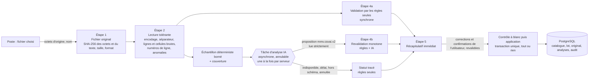
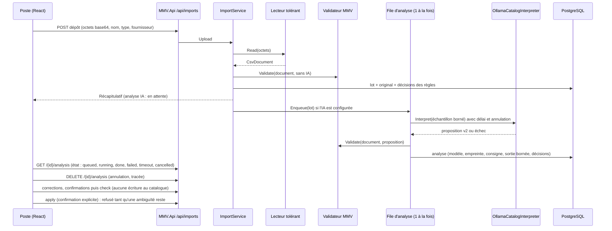

# Lot CSV-IMPORT-AI-01 — Lot B : conception de l'import CSV intelligent (04/11/2026, révision B0)

Mandats : [`prompts/MMV_V2_MANDAT_CSV_IMPORT_AI_01_2026-11-04.md`](../../../prompts/MMV_V2_MANDAT_CSV_IMPORT_AI_01_2026-11-04.md) § 4 à 7, puis GO conditionnel du propriétaire (Gate A) pour le Lot B0. Registre : [`CSV_IA_05.md`](CSV_IA_05.md). Bancs qui fondent cette conception : Lot A [`evidence/csvai/RAPPORT_BENCHMARK.md`](evidence/csvai/RAPPORT_BENCHMARK.md) (contrat v1) et Lot B0 [`evidence/csvai/b0/RAPPORT_B0.md`](evidence/csvai/b0/RAPPORT_B0.md) (contrat v2 et validateur prototype).

**Statut (04/11/2026, Gate B) : `DRAFT RÉVISÉ APRÈS B0 — GATE B OUVERTE, DOSSIER REMIS ; AMENDÉ PAR CSV_IA_05_GATE_B.md`.** Statut précédent (conservé) : `DRAFT RÉVISÉ APRÈS B0 — GATE B NON OUVERTE`. Aucune ligne de code applicatif, aucune migration, aucun SQL. La révision du 04/11/2026 (après B0) remplace les choix du brouillon initial listés au § 11 ; elle ne modifie aucun résultat du Lot A.

> Note datée 04/11/2026 (Gate B, mandat de refonte) : Gate B ouverte ; ce document reste la référence du contrat v2, des règles et de l'échantillonnage. Il est **complété et, sur cinq points, amendé** par le dossier [`CSV_IA_05_GATE_B.md`](CSV_IA_05_GATE_B.md) (§ 3.2 : corrections dans l'assistant en révisions append-only, IA automatique par défaut, application refusée pendant l'analyse, routes additives séparées, tables `batch_assistant` et `batch_analysis_events`). Le texte ci-dessous n'est pas réécrit.

## 1. Architecture avant (existant, cartographié le 04/11/2026)

| Étape | Où | Fichier responsable | Comportement actuel |
| --- | --- | --- | --- |
| Choix du fichier, décodage | poste | `apps/desktop/src/catalog/csvFile.ts` (`decodeCsv`, `detectDelimiter`, `applyCorrections`) | BOM, UTF-8 strict, sinon Windows-1252 ; **le poste décode** et envoie du **texte** ; une correction de valeur réécrit un nouveau fichier, qui devient un nouveau lot |
| Écran d'import | poste | `apps/desktop/src/catalog/ImportView.tsx` | dépôt, aperçu, correspondance, précisions, contrôle à blanc, application |
| Routes | API | `src/MMV.Api/Catalog/StockEndpoints.cs` (groupe `/api/imports`) | `POST /` dépôt, `POST /{id}/check`, `POST /{id}/apply`, `POST /{id}/cancel`, `GET /fields`, `GET /assistant`, `GET /profiles/{supplierId}/{kind}` |
| Lecture CSV | Application | `src/MMV.Application/Catalog/CsvTable.cs` | lecture **stricte** : en-tête obligatoire et unique, refus si une ligne a plus de cellules que l'en-tête, lignes vides retirées |
| Correspondance | Application | `ImportMapper` (synonymes) + `ImportAssistantMerge` (`ImportAssistantAi.cs`) | règles d'abord ; l'IA ne propose que des correspondances **colonne → champ** à partir des en-têtes et de 4 exemples ; montants « à confirmer » ; `ValuesFit` |
| IA locale | API | `src/MMV.Api/Installation/ImportAssistantService.cs` (`OllamaImportAssistant`) | `llama3.2`, boucle locale obligatoire, schéma à clés fixes, délai 60 s, repli par les règles |
| Contrôle et application | Application | `src/MMV.Application/Catalog/ImportService.cs` | contrôle à blanc par ligne (`ImportRow` : valeurs, issue, erreurs), application tout ou rien rejouée dans la transaction, refus du même fichier déjà appliqué (SHA-256), profil fournisseur appris |
| Persistance | Domain / Infrastructure | `src/MMV.Domain/CsvImport/ImportBatch.cs`, `SupplierImportProfile.cs` ; tables `imports.*` | lot : nom, **SHA-256 du texte décodé**, texte, correspondance JSON, statut ; lignes : valeurs JSON, issue, erreurs JSON. **L'analyse de l'IA n'est pas conservée** (seuls le statut et le modèle sont dans l'audit) |
| Champs importables | Application | `ImportService.Fields` | catalogue : famille, marque, modèle, variante, coloris, SKU, références, EAN, politique, verre (fabricant, gamme, indice, traitements), fournisseur ; **aucun attribut de famille** (calibre, puissance, rayon, diamètre, conditionnement…) |
| Tests | — | `tests/MMV.Api.Tests/Catalog/ImportAssistantTests.cs` (32), `tests/MMV.PostgreSql.Tests/Phase05ImportAssistantTests.cs` (4), scénario natif `apps/desktop/e2e/native-uxai.mjs` | — |
| Traitement asynchrone | — | aucun | analyse synchrone dans la requête de dépôt (`ImportService.UploadAsync` → `AnalyzeAsync`) |

Dépendances : `ImportView` → `/api/imports` → `ImportService` → (`CsvTable`, `ImportMapper`, `IImportMappingAssistant`, `IImportStore`, `IImportProfileStore`, `ICatalogStore`, `IPricingStore`, `ICatalogUnitOfWork`, `IAuditRecorder`). L'IA n'a aucun accès à la base ; elle ne voit que ce que `ImportService` lui transmet.

Contraintes de schéma relevées pour le § 7 (migration `20261030005557_CatalogStockModule`) : `ck_batches_size` (`octet_length(content) <= 2097152`, `row_count <= 5000`), index unique `ux_batches_applied_file (file_sha256, kind, store_id)` filtré sur `status = 'applied'`, déclencheurs `trg_batches_frozen` (lot clos figé, suppression refusée) et `trg_batches_no_truncate`.

## 2. Architecture après (révisée après B0)

Principe mesuré par B0 : **l'IA propose une interprétation des colonnes ; le serveur détermine les valeurs, les rattachements, les regroupements et la validité métier.** Le validateur est **monotone** : une proposition de l'IA peut ajouter un doute (`AMBIGU`), jamais rendre importable une décision que les règles seules ne rendent pas importable. Conséquence assumée : l'automatisation vient des règles ; l'IA apporte des suggestions pour ce qui reste à confirmer et des désaccords qui peuvent rattraper une erreur des règles.

Réponse à Q-CSVAI-02 (attente de 40 à 60 s refusée comme blocage obligatoire) : **analyse par les règles immédiate, analyse par l'IA asynchrone**.





### 2.1 Composants

| Composant | Couche | Rôle | Nouveau / modifié |
| --- | --- | --- | --- |
| `CsvDocument` / `TolerantCsvReader` | Application (`Catalog`) | Étape 2. Prototype éprouvé par les deux bancs (`TolerantReader`, copié à l'identique dans le harnais B0) : BOM, UTF-8 strict, sinon Windows-1252, UTF-16 avec BOM ; séparateur `;` `,` tabulation `\|` ; guillemets RFC 4180, cellules multilignes ; **aucune ligne retirée** ; anomalies par ligne (`fewer_cells`, `more_cells`, `empty_line`, `multiline_cell`, `stray_quote`, `unterminated_quote`) ; aucune cellule décalée | nouveau (`CsvTable` conservé pour `suppliers` et `prices`) |
| `CatalogSampler` | Application | Échantillon déterministe (§ 3.3) et rapport de couverture | nouveau |
| `ICatalogInterpreter` / `OllamaCatalogInterpreter` | Application / API (`Installation`) | Étape 3. Contrat v2, lecture stricte, délai, annulation, repli | nouveau (reprend la mécanique éprouvée de `OllamaImportAssistant`) |
| `ImportAnalysisQueue` | API (service hébergé) | Une analyse à la fois par serveur ; états `queued`, `running`, `done`, `failed`, `timeout`, `cancelled` ; annulation par l'utilisateur ; aucune analyse sur la requête HTTP | nouveau |
| `CatalogInterpretationValidator` | Application | Étape 4 : règles du § 4 ; monotone | nouveau |
| `CatalogMaterializer` | Application | Applique les décisions à **toutes** les lignes ; regroupe les variantes ; identité reprise des lignes de continuation avec provenance | nouveau |
| `ImportService` | Application | Branche le flux ; contrôle et application **inchangés** (transaction, idempotence, permissions, refus du réimport) ; attributs de famille ajoutés au plan catalogue | modifié |
| `ImportView` | poste | Envoie les octets d'origine ; affiche le récapitulatif, l'état de l'analyse IA, les valeurs d'origine, les statuts ; recueille corrections et confirmations. **Aucune règle métier côté React** | modifié |

### 2.2 Application pendant l'analyse IA

Comme l'IA ne peut qu'ajouter des doutes, appliquer sans elle est sûr au regard des règles, mais prive l'utilisateur du filet de sécurité qui rattrape une erreur des règles (désaccord règle / IA). Proposition : l'application attend la fin de l'analyse IA **ou** une décision explicite « continuer sans l'assistant », tracée dans l'audit. À trancher : Q-CSVAI-08.

## 3. Contrat de sortie de l'IA — `mmv.csvai.v2` (mesuré par B0)

Le modèle ne produit **rien ligne par ligne** : ni nature de ligne, ni famille de ligne, ni regroupement, ni valeur. Il propose la présence d'en-têtes, le champ de chaque colonne et une règle de famille.

```json
{
  "header": "present | absent",
  "columns": {
    "c0": { "field": "<un des 49 champs MMV | unknown>", "confidence": "high | medium | low", "issue": "<code de colonne | none>" }
  },
  "family": {
    "mode": "single | by_column | unknown",
    "single": "<famille | unknown>",
    "column": "<colonne candidate | none>",
    "values": { "<colonne candidate>": { "<valeur distincte>": "<famille | unknown>" } }
  }
}
```

- Schéma JSON généré pour chaque fichier, **clés fixes** (`c0…cN`, colonnes candidates, valeurs distinctes), toutes les valeurs énumérées, `additionalProperties: false` à tous les niveaux. `values` n'existe que s'il y a des colonnes candidates.
- **Colonnes candidates à la famille** (choisies par le serveur, au plus 2) : intitulé de famille ou de type (`type`, `famille`, `family`, `catégorie`, `category`, `univers`), 2 à 12 valeurs distinctes non vides sur **tout** le fichier, en-tête sans consigne. Ainsi la table `values` couvre toutes les lignes, échantillonnées ou non.
- Champs : les 49 du banc v1 (`Lex.Fields` du harnais B0, identiques à `Contract.Fields` du harnais v1). Familles : les 6 familles MMV.
- **Lecture stricte** (`Strict.Parse`) : JSON invalide, clé manquante ou en trop, valeur hors énumération, réponse tronquée (`done_reason = length`) donnent `invalid_output` ; la réponse est écartée **en entier** et seules les règles s'appliquent. Une règle de famille incohérente (par exemple `mode = single` avec `single = unknown`) est acceptée mais comptée et sans effet.
- Retirés du brouillon initial : `role` (le serveur déduit le rôle du champ), `continuation` (le serveur détecte les lignes de continuation), `sample_rows` (aucune sortie par ligne).
- Paramètres : `think: false`, `temperature 0`, `top_k 1`, `top_p 1`, `seed 7`, pénalités neutralisées, `num_ctx 8192`, `num_predict 2048`, `keep_alive 30m`. Consigne : [`evidence/csvai/b0/bench/system_prompt_v2.txt`](evidence/csvai/b0/bench/system_prompt_v2.txt).

### 3.1 Entrée du modèle

Données balisées `<data>…</data>`, jamais des consignes : métadonnées (encodage, séparateur, nombre de lignes et de colonnes, nombre de lignes échantillonnées ; nom de fichier masqué), statistiques par colonne calculées sur **tout** le fichier hors L1 (valeurs distinctes, cellules vides), colonnes candidates à la famille avec leurs valeurs, puis l'échantillon (lignes numérotées comme dans le fichier, cellules en tableau, tronquées à 160 caractères, caractères de contrôle retirés). Exemples : [`example_user_message_F01.txt`](evidence/csvai/b0/bench/example_user_message_F01.txt), [`example_user_message_F17.txt`](evidence/csvai/b0/bench/example_user_message_F17.txt).

### 3.2 Traçabilité

Avec chaque analyse : version du contrat, modèle, empreinte (`digest`), version d'Ollama, empreintes de la consigne, du message et de l'échantillon, durée, jetons, statut, sortie brute bornée (64 Kio), décisions du validateur. Une nouvelle analyse est une nouvelle entrée ; aucune n'est réécrite (§ 7).

### 3.3 Échantillonnage déterministe (correction « Échantillonnage »)

Fichier de 40 lignes ou moins : fichier entier. Sinon, au plus 40 lignes, choisies dans cet ordre de priorité, toujours de la même façon pour les mêmes octets :

1. début du fichier (6 premières lignes, en-tête compris) ;
2. une ligne par dixième du fichier (positions réparties) ;
3. la première ligne de chaque valeur des colonnes candidates à la famille ;
4. la première ligne de chaque **structure de ligne** fréquente (nombre de cellules et classe de chaque cellule : vide, nombre, texte, suspecte) — c'est ainsi qu'un changement de format en cours de fichier est vu ;
5. la première ligne de chaque **anomalie** : anomalie du lecteur, cellule suspecte ou formule par colonne, classe de valeur minoritaire d'une colonne ;
6. la première ligne de chaque famille détectée par les mots-clés ;
7. complément par positions régulières.

Le rapport de couverture (début, positions, valeurs de famille, structures, anomalies, mots-clés) est conservé. **Si une catégorie n'est pas entièrement couverte, l'analyse IA est déclarée incomplète** : les suggestions restent affichées comme telles, et aucune décision n'en dépend de toute façon (monotonie). Sur les deux fichiers de plus de 300 lignes de B0, la couverture a été complète avec 40 lignes.

## 4. Validation métier MMV (étape 4, déterministe) — règles révisées

Chaque colonne, chaque famille de ligne, chaque produit (regroupement) et chaque cellule reçoit **un** statut.

| Statut | Sens | Effet |
| --- | --- | --- |
| `VALIDE` | règle MMV satisfaite | importable sans question |
| `AVERTISSEMENT` | importable, mais à relire (unité retirée, clé EAN fausse, consigne suspecte gardée en simple texte) | non bloquant, affiché |
| `AMBIGU` | plusieurs sens possibles, désaccord règle / IA, montant ou famille non confirmés | **bloquant** jusqu'au choix de l'utilisateur ; le serveur refuse l'application |
| `INVALIDE` | règle MMV violée (format, plage, formule, consigne dans une identité, ligne mal alignée, doublon d'EAN ou de référence) | **bloquant** pour la ligne |
| `NON RECONNU` | colonne sans champ MMV ; suggestion de l'IA sans règle qui la confirme | conservée dans les données d'origine du lot, jamais importée en silence |

### 4.1 Principes

- **P1 — Monotonie.** Une décision importable avec l'IA l'est aussi par les règles seules, avec le même champ, la même famille, le même produit et la même valeur. B0 l'a vérifié sur 21 080 mutations de propositions et sur toutes les sorties réelles (`RAPPORT_B0.md`).
- **P2 — Autorité des règles.** `VALIDE` ne vient que d'une règle (intitulé + contrôle des valeurs), d'un profil fournisseur appris ou d'une confirmation de l'utilisateur. Une suggestion de l'IA sans règle reste `NON RECONNU` (fichier avec en-têtes) ou `AMBIGU` (fichier sans en-têtes) ; elle pré-remplit le choix de l'utilisateur.
- **P3 — L'IA peut bloquer.** Désaccord entre la règle et l'IA, ou anomalie signalée par l'IA sur une colonne validée par la règle : `AMBIGU`. C'est le filet qui rattrape une erreur des règles.
- **P4 — Valeurs.** Toute valeur importée est dérivée de la seule valeur brute de sa cellule (ligne, colonne, valeur brute conservées) ; aucune valeur n'est inventée.

### 4.2 Règles de colonne

| Règle | Contenu révisé |
| --- | --- |
| **C1 — Montants (correction C1)** | Trois notions distinctes : (1) **correspondance apprise** — le profil fournisseur, enregistré lors d'une application confirmée, **propose** le champ d'une colonne ; (2) **validation technique** — toujours exigée : valeurs monétaires (≥ 80 % d'entiers ou de décimaux, aucun négatif, aucun pourcentage), format lisible ; (3) **confirmation commerciale** — exigée pour toute colonne de montant **sauf** si l'intitulé qualifie explicitement le montant (achat ; vente + HT ou TTC) **ou** si le profil appris porte le même intitulé et la validation technique passe. Un montant non qualifié (`Prix`, `Px`, `Tarif`) ou qualifié seulement par l'IA reste `AMBIGU`. **Aucune décision du modèle ne lève une confirmation commerciale** : l'IA peut seulement en ajouter une (désaccord). `priceUnqualified` est toujours `AMBIGU` |
| C2 — Pourcentages | Intitulé avec `%`, ou `remise` / `discount` / `taux` sans mot de prix, ou ≥ 30 % de valeurs en `%` : **jamais** un montant ; proposition de montant de l'IA **refusée** (« erreur bloquée ») |
| C3 — Codes-barres | `barcode` exige ≥ 80 % de valeurs de 8 à 14 chiffres ; une colonne de références dont les valeurs ont ce format passe en `AMBIGU` |
| **C4 — Références (correction C4)** | Les références alphanumériques **et** entièrement alphabétiques sont acceptées. Seuls : un intitulé qui désigne un **nom** de marque ou de fabricant (`Fabricant`, `Marque`, `Brand`, sans `réf` / `code`) rend la proposition de référence **refusée** ; une valeur répétée (≤ 2 valeurs distinctes sur ≥ 4 lignes), des libellés à plusieurs mots ou des valeurs au format code-barres donnent `AMBIGU`. Un intitulé non qualifié (`Réf`, `Référence`, `Code`, `Item code`, `Code article`) reste `AMBIGU` entre référence fournisseur et fabricant. `SKU` interne seulement sur intitulé explicite. En cas de doute : `AMBIGU` |
| C5 — Sans en-têtes | Toutes les colonnes `AMBIGU` (suggestions de l'IA ou du profil des valeurs) ; confirmation colonne par colonne. Désaccord règle / IA sur la présence d'en-têtes : en-tête `AMBIGU`, toutes les colonnes `AMBIGU`, la ligne 1 n'est ni retirée ni importée |
| C6 — Confiance | Sans effet sur la validité (l'IA ne valide rien) ; sert à ordonner les suggestions |
| C7 — Doublons | En-têtes normalisés identiques : `AMBIGU` ; un même champ sur plusieurs colonnes (sauf coloris, déclinaison, remarque) : `AMBIGU` |
| C8 — Champ / famille | Champ propre à une famille absente du fichier : `AMBIGU` |
| C9 — Contrôle des valeurs | Plages et formats par champ (calibre 20–80, pont 5–40, branche 80–180, puissance décimale signée ≤ 30, devise ISO, TVA, entiers de conditionnement…) ; une règle d'intitulé contredite par les valeurs devient `AMBIGU` ; une proposition de l'IA contredite par les valeurs est **refusée** |
| C10 — En-tête suspect | Un intitulé qui contient une consigne ne fournit **aucun** sens ; la colonne reste `NON RECONNU` |
| C11 — Contenu mixte | Colonne dont les valeurs mêlent nombres et mots (≥ 15 % chacun), ou mesure contenant des valeurs composites : `AMBIGU` |

### 4.3 Règles de cellule

- **Nombres (correction CSV)** : lus en chaînes décimales, jamais en flottant. **Un décimal signé (`-1,25`, `+2,00`) est un nombre, jamais une formule** ; son signe est conservé. Formule de tableur = cellule commençant par `=` ou `@`, ou par `+` / `-` **non suivis d'un décimal simple** : refusée (`INVALIDE`). Séparateur de milliers ou décimal ambigu (`1.234`, `1.234,00`, `1 290,00`) : `AMBIGU`, jamais deviné (D-UX-06).
- **Unités** : `mm` retiré d'un diamètre ou d'un rayon, `ml` d'une contenance, libellé d'unité d'un conditionnement (`30 lentilles`) : `AVERTISSEMENT`, valeur d'origine affichée. Unité différente (`0,1 L` pour une contenance, `360 ml` pour un conditionnement) : `AMBIGU`, **aucune conversion**.
- **Montants** : symbole retiré (`42,50 €`) en `AVERTISSEMENT` ; négatif ou illisible : `INVALIDE`.
- **Codes-barres** : 8, 12, 13 ou 14 chiffres ; clé GTIN fausse : `AVERTISSEMENT` ; autre longueur : `INVALIDE` ; EAN en double dans le fichier : `INVALIDE`.
- **Références** : 40 caractères au plus ; consigne dans la valeur : `INVALIDE` ; doublon dans le fichier : `INVALIDE`.
- **Consignes injectées** : une cellule suspecte (motifs `ignore`, `instructions`, `SYSTEM:`, `</data>`, `note pour l'IA`, JSON, verbes d'action sur colonnes / lignes / familles…) n'est jamais interprétée : `AVERTISSEMENT` dans une remarque (gardée comme texte), `INVALIDE` dans une valeur d'identité (marque, modèle, désignation, famille, gamme) ou une référence. Les mots-clés de famille ne sont jamais lus dans une remarque ni dans une colonne non reconnue.

### 4.4 Famille d'une ligne

Preuves **déterministes**, jamais tirées de l'IA : (a) valeur d'une colonne de famille reconnue par la règle (codes `MON`, `SOL`, `LEN`, `ENT`, `VER`, `ACC`, `PRE`… ou mots-clés) ; un code inconnu (`DIV`) est une contradiction ; (b) mots-clés dans les colonnes de désignation (priorité : prestation, accessoire, solaire, lentille, verre, monture) ; (c) champs validés par la règle qui n'existent que pour certaines familles (mesures de monture → montures ou solaires ; puissance, rayon, renouvellement → lentilles ; indice, plages, gamme → verres). La famille est `VALIDE` si les preuves désignent **une seule** famille et que l'IA ne la contredit pas. Sans preuve, preuves contradictoires, ou montures / solaires non départagées par un mot-clé : `AMBIGU`, la suggestion de l'IA pré-remplit le choix. **Aucune famille n'est imposée sans preuve** ; une demande de famille injectée ne peut donc pas passer.

### 4.5 Variantes (regroupement déterministe)

- Clé de produit = famille + valeurs normalisées de marque et modèle (sinon désignation, sinon gamme) ; pour les verres : fabricant, gamme, géométrie, indice, matériau, traitements (cible : référentiel des verres et offres fournisseurs, Q-CSVAI-04).
- Lignes de continuation : ligne bien alignée dont **toutes** les cellules d'identité sont vides, juste après un article ; identité reprise avec provenance « reprise de Ln », **à confirmer** (une confirmation par fichier) ; aucune autre valeur reprise (un prix vide reste vide).
- Produit `AMBIGU` si une colonne d'identité n'est pas validée (ou attend un choix), si une famille du groupe est à confirmer, si deux lignes ont les mêmes déclinaisons (doublon potentiel), ou si les déclinaisons ne sont pas distinguées. Les colonnes de déclinaison sont choisies d'après les règles, pas d'après l'IA.
- Ligne mal alignée ou d'identité invalide : jamais regroupée.
- Limite connue : une désignation qui inclut la déclinaison (`LU-2041 Écaille`) produit un produit par ligne (rappel perdu, aucune association fausse).

### 4.6 Ce qui reste comme aujourd'hui

Contrôle à blanc obligatoire, application tout ou rien rejouée contre l'état courant, idempotence par identifiant de requête, refus du même fichier déjà appliqué (empreinte du **texte**, inchangée, § 7.2), droits `catalog.import`, `costs.write`, `pricing.manual`, aucune suppression, modèle fournisseur appris à l'application (jamais le séparateur décimal).

## 5. Récapitulatif avant import (étape 5)

L'écran affiche, à partir des seules données du serveur : lignes analysées, articles, produits, variantes, familles identifiées ; colonnes reconnues et non reconnues ; erreurs, avertissements, ambiguïtés ; doublons potentiels ; état de l'analyse IA (en attente, en cours, terminée, échouée, annulée, incomplète). Pour chaque colonne : en-tête, valeurs d'origine, champ retenu, origine (règle, profil, IA, utilisateur), statut, suggestion de l'IA. Pour chaque cellule signalée : ligne, colonne, **valeur brute**, interprétation, statut, raison. Les confirmations sont regroupées (une par colonne, une par classe de famille, une pour les lignes de continuation) ; B0 en compte le nombre par fichier. Une valeur ne se corrige que par un nouveau fichier (nouveau lot). **Rien n'est écrit au catalogue avant la confirmation explicite** ; tant qu'il reste une ambiguïté, le serveur refuse l'application.

> Note datée 04/11/2026 (Gate B) : la phrase « Une valeur ne se corrige que par un nouveau fichier (nouveau lot) » est remplacée, à la demande du mandat de refonte, par des corrections dans l'assistant enregistrées en révisions append-only et revalidées par le serveur ([`CSV_IA_05_GATE_B.md`](CSV_IA_05_GATE_B.md) § 4.3).

## 6. Communication avec Ollama

Le poste n'appelle jamais Ollama : seul le serveur l'interroge, sur la boucle locale (contrôle existant `IsLoopback`). Configuration `ImportAssistant` étendue : `Model` (`qwen3.5:4b` retenu comme candidat principal, activation après validation serveur — Q-CSVAI-01), `TimeoutSeconds` (à fixer après mesures sur le matériel des magasins ; aucun SLA définitif), `KeepAlive`, `MaxSampleRows` (40), `Think` (`false`). Une analyse à la fois par serveur (file d'attente) ; annulation par l'utilisateur ; état servi par `GET /api/imports/{id}/analysis`. Sur indisponibilité, délai, HTTP en erreur, sortie hors schéma ou annulation : statut tracé, règles seules, **aucune erreur bloquante pour l'utilisateur et aucun import partiel**. Réimport d'un fichier déjà analysé (mêmes octets, même contrat, même modèle et même consigne) : l'analyse conservée est réutilisée, sans nouvelle inférence.

## 7. Persistance, traçabilité et schéma — proposition pour `0009` (aucun SQL)

Décision de principe du propriétaire : **option B** (migration additive `0009` dans un dossier G05-SQL distinct). Ce paragraphe prépare l'ADR et le dossier SQL ; il ne crée ni n'applique aucun SQL.

### 7.1 Étude « Stockage et conservation » (correction demandée)

| Point | Constat | Conséquence |
| --- | --- | --- |
| Taille | Un lot est déjà borné à 2 Mio de texte et 5 000 lignes (`ck_batches_size`) | l'original est borné de même (2 Mio d'octets ; un UTF-16 de 2 Mio de texte dépasserait : refus explicite) |
| Croissance | Les lots ne sont jamais supprimés (`trg_batches_frozen`, `trg_batches_no_truncate`) | conserver l'original **double au plus** l'espace d'un lot ; ordre de grandeur pour un magasin : quelques dizaines d'imports par an de quelques dizaines à quelques centaines de Kio, soit quelques dizaines de Mio par an, compressés par TOAST |
| Sauvegardes | Procédure `pg_dump` / `pg_restore`, copie hors machine, restauration testée ([`docs/INSTALLATION_RESEAU_SECURITE.md`](../../INSTALLATION_RESEAU_SECURITE.md) § 5) | les originaux entrent dans la sauvegarde ; le format personnalisé de `pg_dump` les compresse ; mesurer la taille sur une base de test lors du lot G05-SQL |
| Rétention | Aucune politique aujourd'hui ; un lot clos est figé | stocker l'original **hors** de `imports.batches` permet de purger les octets (en gardant empreinte, taille, encodage) sans toucher au lot figé ; durée à décider (Q-CSVAI-07) |
| Accès | Contenu de catalogue fournisseur, prix d'achat compris | lecture et téléchargement réservés à `catalog.import` (et `costs.read` si le lot contient des coûts), audités ; jamais servis au poste sans droit |

Recommandation : **tables séparées** plutôt que colonnes `original_bytes bytea` sur `imports.batches` (le brouillon initial), pour la rétention, pour ne pas alourdir les lectures des lots et pour garder le lot figé intact.

### 7.2 Identité des fichiers (correction « Identité des fichiers »)

- Aujourd'hui `file_sha256` = SHA-256 du **texte décodé par le poste**, réencodé en UTF-8 ; l'index unique `ux_batches_applied_file` en dépend (refus du même fichier déjà appliqué).
- Proposition : **ne pas changer le sens de `file_sha256`** (le mécanisme d'idempotence reste intact, les lots existants restent reconnus) ; ajouter l'empreinte des **octets d'origine** à côté, pour la provenance et l'immuabilité.
- Deux fichiers d'octets différents peuvent donner le même texte (avec ou sans BOM, UTF-8 ou Windows-1252 pour un texte ASCII) : ils restent « le même fichier » pour le refus du réimport, ce qui est le comportement métier voulu.
- Transition : le serveur décode les octets avec **les mêmes règles** que `decodeCsv` du poste ; un test d'équivalence (corpus des bancs) garantit que l'empreinte du texte calculée par le serveur égale celle que le poste aurait produite. Les lots antérieurs n'ont pas d'original (absence assumée, aucune réécriture).
- **B0 ne modifie pas l'idempotence** (exigence du mandat) ; tout cela relève de B1 et du lot G05-SQL.

### 7.3 Schéma proposé (à arrêter par l'ADR et le dossier G05-SQL)

| Table | Colonnes proposées | Règles |
| --- | --- | --- |
| `imports.batch_originals` | `batch_id` (PK, FK `imports.batches`), `original_sha256 char(64)`, `byte_length int` (≤ 2 097 152), `encoding varchar(16)`, `delimiter varchar(4)`, `bytes bytea` (nullable après purge), `stored_at_utc`, `purged_at_utc` (nullable) | insertion à la création du lot ; seule mise à jour permise : purge des octets par une procédure de maintenance tracée ; aucune suppression |
| `imports.batch_analyses` | `id` (PK), `batch_id` (FK), `attempt int`, `contract varchar(32)`, `model varchar(100)`, `model_digest char(64)`, `ollama_version varchar(32)`, `prompt_sha256`, `sample_sha256`, `status varchar(16)`, `started_at_utc`, `ended_at_utc`, `duration_ms`, `eval_count`, `coverage jsonb`, `raw_output text` (≤ 64 Kio), `proposal jsonb`, `decisions jsonb`, `requested_by_user_id` | ajout seulement ; une analyse par tentative ; aucune réécriture |
| `imports.batch_decisions` (ou extension de `mapping`) | choix de l'utilisateur sur colonnes, familles, continuation, doublons, avec auteur et horodatage | revalidés par le serveur à chaque contrôle |

`imports.rows` est inchangée : la provenance (ligne, colonne, valeur brute, statut) va dans le JSON des valeurs.

## 8. Plan d'implémentation proposé (après Gate B)

| Étape | Contenu | Sortie |
| --- | --- | --- |
| B0 | **Fait le 04/11/2026** : banc du contrat v2 et validateur prototype | [`evidence/csvai/b0/RAPPORT_B0.md`](evidence/csvai/b0/RAPPORT_B0.md) |
| B1 | `TolerantCsvReader`, `CsvDocument`, décodage serveur équivalent au poste, `CatalogSampler` + tests (corpus des deux bancs en fixtures) | lecture sans perte, CSV-04, CSV-05 |
| B2 | `CatalogInterpretationValidator` + `CatalogMaterializer` (règles du § 4, monotonie testée par mutations) | CSV-01 à CSV-10, CSV-17, CSV-18 |
| B3 | `ICatalogInterpreter` + `OllamaCatalogInterpreter` + `ImportAnalysisQueue` (asynchrone, annulation, délai, repli) | CSV-11 à CSV-13, CSV-19 |
| B4 | Branchement dans `ImportService`, attributs de famille, contrats API additifs | parcours API réels |
| B5 | `ImportView` : octets, récapitulatif, état de l'analyse, confirmations | aucune logique métier côté React |
| B6 | Migration `0009` en lot G05-SQL distinct (§ 7.3) | — |
| B7 | Suites complètes, scénario natif deux postes avec Ollama réel, mesure sur le matériel des magasins, documents, livraison | Gate D |

Contrats API (additifs, sans rupture) : `POST /api/imports` accepte `contentBase64` à côté de `content` ; l'aperçu ajoute `interpretation` (colonnes, familles, produits, cellules signalées, origine, statut), `encoding`, `readerAnomalies`, `analysis` (état) ; `POST|GET|DELETE /api/imports/{id}/analysis` ; `POST /{id}/check` accepte les choix et confirmations. Aucune permission nouvelle. Aucune dépendance nouvelle.

## 9. Matrice QA du lot (prévue — application `NOT_TESTED`)

Les preuves B0 portent sur un **prototype hors application** ; elles ne remplacent pas les tests des parcours réels. Colonne « B0 » : résultat du prototype sur le corpus des bancs.

| ID | Scénario | Fixture | Résultat attendu | Niveau de test | B0 (prototype) | Application |
| --- | --- | --- | --- | --- | --- | --- |
| CSV-01 | CSV classique | F01 | correspondances correctes, solaire reconnue, montures `AMBIGU` sans mot-clé | API + PostgreSQL | voir rapport B0 | NOT_TESTED |
| CSV-02 | sans en-têtes | F02 | aucune ligne prise pour un en-tête ; toutes les colonnes `AMBIGU` | API + PostgreSQL | voir rapport B0 | NOT_TESTED |
| CSV-03 | colonnes réordonnées | F03 | correspondances correctes, `Gender` `NON RECONNU` | API | voir rapport B0 | NOT_TESTED |
| CSV-04 | lignes irrégulières | F08, F16, F17 | anomalies du lecteur, aucune cellule décalée, lignes `INVALIDE` | unitaire + API | voir rapport B0 | NOT_TESTED |
| CSV-05 | encodages | F09, F03, F17 | Windows-1252 et BOM lus ; octets non réencodables : erreur explicite | unitaire + API | lecture conforme (B0) ; erreur explicite non testée | NOT_TESTED |
| CSV-06 | plusieurs familles | F07, F17 | règle de famille par colonne ; code inconnu `AMBIGU` ; colonnes à sens variable `AMBIGU` | API + PostgreSQL | voir rapport B0 | NOT_TESTED |
| CSV-07 | variantes | F01, F04, F05, F06, F16, F17 | regroupement serveur ; continuation reprise et à confirmer ; aucune association fausse importable | API + PostgreSQL | voir rapport B0 | NOT_TESTED |
| CSV-08 | prix ambigus | F11, F04, F14 | `AMBIGU`, application refusée tant que non confirmé | API + PostgreSQL | voir rapport B0 | NOT_TESTED |
| CSV-09 | valeur inconnue | F14, F17 (`DIV`) | `NON RECONNU` ou `AMBIGU`, aucune valeur créée | API | voir rapport B0 | NOT_TESTED |
| CSV-10 | colonnes inconnues | F14, F06, F17 | conservées dans le lot, non importées | API | voir rapport B0 | NOT_TESTED |
| CSV-11 | injection | F13/F15, F18/F19, F16/F20 | aucune divergence dangereuse entre fichier injecté et témoin | API (Ollama réel) + faux service | voir rapport B0 | NOT_TESTED |
| CSV-12 | Ollama indisponible | faux service | statut tracé, règles seules, aucune écriture au catalogue | API + PostgreSQL | NOT_TESTED | NOT_TESTED |
| CSV-13 | JSON invalide | faux service | `invalid_output`, sortie écartée en entier | unitaire + API | lecture stricte prototypée (B0) | NOT_TESTED |
| CSV-14 | import interrompu | annulation et échec en cours d'application | rien d'écrit, lot rejouable | PostgreSQL | NOT_TESTED | NOT_TESTED |
| CSV-15 | réimport du même fichier | F01 deux fois | refus `409` après application ; analyse réutilisée avant | API + PostgreSQL | NOT_TESTED | NOT_TESTED |
| CSV-16 | modification manuelle | F02 | choix conservés après contrôle et application | API + PostgreSQL + natif | NOT_TESTED | NOT_TESTED |
| CSV-17 | monotonie du validateur | 20 fichiers, mutations | aucune décision importable ajoutée par l'IA | unitaire | voir rapport B0 | NOT_TESTED |
| CSV-18 | nombres signés / formules | F04, F05, F17, F18 | `-1,25` conservé ; `=…`, `@…` refusés | unitaire | voir rapport B0 | NOT_TESTED |
| CSV-19 | analyse asynchrone | gros fichier, annulation, délai | récapitulatif immédiat par les règles ; état suivi ; annulation tracée | API + natif | NOT_TESTED | NOT_TESTED |
| CSV-20 | échantillonnage | F16, F17 | couverture complète ou analyse déclarée incomplète | unitaire | voir rapport B0 | NOT_TESTED |
| CSV-F1 | montures | F01, F02, F03, F10, F16 | mesures validées ; composite découpé seulement sur motif exact | API | voir rapport B0 | NOT_TESTED |
| CSV-F2 | lentilles | F04, F05, F12, F18 | puissance signée, rayon, diamètre, conditionnement ; unités hétérogènes `AMBIGU` | API | voir rapport B0 | NOT_TESTED |
| CSV-F3 | verres | F06, F17 | plages cohérentes ; cible référentiel des verres et offres | API + PostgreSQL | voir rapport B0 | NOT_TESTED |
| CSV-N1 | parcours natif | F01, F07, F13 | deux postes Tauri, API réelle, Ollama réel, captures | natif | NOT_TESTED | NOT_TESTED |

## 10. Risques

| Risque | Mesure prévue |
| --- | --- |
| Règles écrites et corrigées sur ce même corpus synthétique (risque de sur-ajustement) | essai sur catalogues réels anonymisés (Q-CSVAI-05) avant Gate D ; tests du lexique sur intitulés non vus ; toute erreur des règles est une erreur des règles seules, mesurable sans IA |
| Fatigue de confirmation : beaucoup de confirmations par fichier, l'utilisateur valide sans lire | confirmations regroupées (colonne, classe de famille, continuation) ; montants présentés avec intitulé et valeurs brutes ; suggestion IA sans choix par défaut pour les montants |
| Temps d'analyse sur le matériel des magasins | analyse IA asynchrone et annulable ; règles immédiates ; mesure sur le matériel réel (BL-05-U2) |
| Erreurs de l'IA | sans effet importable (monotonie) ; elles coûtent au plus une confirmation de plus |
| Injection | aucune décision ne dépend de l'IA ; consignes jamais lues comme mots-clés ; consignes dans une identité ou une référence : `INVALIDE` |
| Montures et solaires non départagées | une confirmation par fichier ; mot-clé requis pour l'automatique |
| Sortie différente d'une version de modèle à l'autre | empreinte du modèle, version d'Ollama, version du contrat et empreinte de la consigne conservées ; réanalyse explicite seulement |
| Volume des originaux | tables séparées, borne de 2 Mio, rétention à décider (Q-CSVAI-07) |

## 11. Historique des révisions

| Date | Révision |
| --- | --- |
| 04/11/2026 (Lot A) | Brouillon initial : contrat v2 avec `role`, `continuation`, `sample_rows` ; échantillon « premières lignes + lignes signalées » ; C1 « montants `AMBIGU` sauf règles sûres » ; C4 « mots sans chiffre refusés comme références » ; option B en colonnes de `imports.batches` (`original_bytes bytea`, `analysis_json`…) ; analyse synchrone avec délai proposé de 120 s. |
| 04/11/2026 (après B0) | Contrat v2 réduit et mesuré (§ 3) ; échantillonnage déterministe avec couverture (§ 3.3) ; validateur monotone (§ 4.1) ; C1 en trois notions (§ 4.2) ; C4 révisée (références alphabétiques acceptées, nom ≠ référence, doute → `AMBIGU`) ; nombres signés distincts des formules (§ 4.3) ; familles sur preuves déterministes (§ 4.4) ; analyse IA asynchrone et annulable (§ 2, Q-CSVAI-02) ; persistance en tables séparées, empreinte du texte conservée pour l'idempotence (§ 7). |
| 04/11/2026 (Gate B) | Mandat de refonte : dossier [`CSV_IA_05_GATE_B.md`](CSV_IA_05_GATE_B.md). Amendements : corrections dans l'assistant (révisions append-only, auteur, revalidation) au lieu d'un nouveau fichier ; IA automatique par défaut (`Mode` configurable) ; application refusée pendant une analyse, vérification sans IA sur choix explicite ; routes additives `/api/imports/assistant…` et inspection sans écriture ; `0009` complétée de `batch_assistant` et `batch_analysis_events` ; diagnostic des doublons de SKU ; exemples représentatifs et `examplesDigest` pour les confirmations de montants. |
