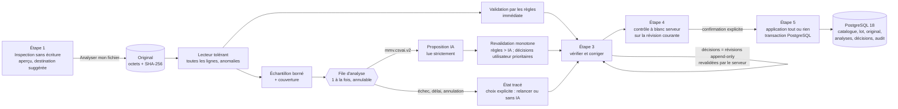

# Lot CSV-IMPORT-AI-01 — Dossier GATE B : refonte de l'assistant d'import (04/11/2026)

Mandat : [`prompts/MMV_V2_MANDAT_REFONTE_CSV_IMPORT_AI_01_GATE_B_2026-11-04.md`](../../../prompts/MMV_V2_MANDAT_REFONTE_CSV_IMPORT_AI_01_GATE_B_2026-11-04.md) (archivé tel que reçu). Registre : [`CSV_IA_05.md`](CSV_IA_05.md). Conception B0 sur laquelle ce dossier s'appuie : [`CSV_IA_05_CONCEPTION.md`](CSV_IA_05_CONCEPTION.md) (contrat `mmv.csvai.v2`, règles C1–C11, validateur monotone, échantillonnage, proposition `0009`). Preuves B0 : [`evidence/csvai/b0/RAPPORT_B0.md`](evidence/csvai/b0/RAPPORT_B0.md).

> Note datée 06/11/2026 : dossier audité « recevable avec réserves » ; **GO conditionnel** du propriétaire ; implémentation livrée (`CSVAI_C1_C2_C3_IMPLEMENTED — G05-SQL-0009 PREPARED, NOT APPLIED — OWNER_SQL_GO_AND_REVIEW_REQUIRED`) — voir [`LIVRAISON_05_CSVAI.md`](LIVRAISON_05_CSVAI.md). Écarts d'implémentation avec ce dossier : action « associer à l'article existant » **non proposée** (décision du 06/11/2026, Q-CSVAI-14) ; référentiel des verres réalisé dans ce cycle (C3, Q-CSVAI-11) ; libellé des montants en « lignes lisibles ». Le texte ci-dessous n'est pas réécrit.

**Statut : `GATE_B — DOSSIER REMIS, VALIDATION DU PROPRIÉTAIRE REQUISE`.** Ce dossier contient l'audit, la conception technique et une **maquette navigable isolée** (banc). **Aucune intégration applicative** : l'écran d'import actuel, l'API, le domaine, l'infrastructure, la configuration et les migrations sont **inchangés** ; aucun SQL, aucune base touchée, aucun modèle téléchargé ; Gates C1, C2, SQL et D **NOT_STARTED**. Aucun commit, push, PR ni merge.

Sommaire : 1 audit · 2 constats sur le parcours actuel · 3 architecture avant/après · 4 les cinq étapes · 5 états UI et captures · 6 matrice des interactions · 7 contrats API · 8 transitions de l'assistant · 9 résultats tardifs et concurrence · 10 modèle Ollama · 11 décisions Q-CSVAI-07 à 10 · 12 persistance `0009` (proposition) · 13 plan par sous-lot · 14 plan de recette · 15 tests de ce gate · 16 fichiers · 17 risques et questions ouvertes · 18 décisions demandées.

## 1. Gate 0 — audit initial (04/11/2026)

| Point | Constat | Statut |
| --- | --- | --- |
| Branche, HEAD | `spike/csv-import-ollama-benchmark`, HEAD `55f021d894e07452d882a85a461bbfc34052c41d` (identique à `feat/phase-05-catalogue-stock`) ; `main` à `0a83a57` | PASS |
| Worktree | un seul (`C:/Users/Ali Zekhnini/Documents/GitHub/MMV V2`) ; `git stash list` vide | PASS |
| État Git | suivis modifiés : `apps/desktop/.env.development` (propriétaire) et 7 documents du lot B0 (README, ADR, backlog, `05.md`, gates, QA, source map) ; non suivis : archives `*.zip`, `.claude/`, `.serena/`, `references/`, documents et preuves CSV-IA du lot. Aucun changement de branche effectué | PASS (réserve consignée, identique au Lot A/B0) |
| `.env.development` | SHA-256 `a215e1f012848afc5f5fb1dd87efadc718c20fb3316201713ef70a18bd7d2e4e`, identique à l'empreinte consignée ; non lu, non touché, jamais indexé | PASS |
| Résultats B0 présents | `RAPPORT_B0.md`, `results/` (résumé, scores, décisions), `runs/` (sorties brutes, consoles), harnais, corpus F16–F20, attendus | PASS |
| Intégrité des preuves B0 | corpus F16–F20 et attendus : **5/5 conformes** au manifeste `corpus/MANIFEST_B0.json` (octets et SHA-256). Les sorties `runs/*.jsonl` et `results/*` n'avaient **aucune empreinte consignée** après le passage : intégrité **non vérifiable rétroactivement** ; empreintes figées ce jour dans [`evidence/csvai/gateb/B0_FREEZE_SHA256_20261104.txt`](evidence/csvai/gateb/B0_FREEZE_SHA256_20261104.txt) (31 fichiers) | PASS (corpus) · NOT_TESTED (sorties, avant gel) |
| Ollama | 0.40.14 ; modèles présents : `qwen3.5:4b` (`d8b0f5e9760c`), `qwen3.5:2b`, `llama3.2:latest` (`a80c4f17acd5`), `llama3`, `sqlcoder` ; aucun modèle chargé ; **aucun téléchargement** | PASS |
| Configuration IA de l'application | `src/MMV.Api/appsettings.json` → `ImportAssistant` : `Enabled true`, boucle locale, `Model "llama3.2"`, `TimeoutSeconds 60` ; valeur par défaut `llama3.2` dans `ImportAssistantOptions` (`src/MMV.Api/Installation/ImportAssistantService.cs:25`). **Seul usage d'Ollama dans le dépôt** : l'import (`ImportAssistantService.cs`, `ImportAssistantAi.cs`, `ImportService.cs`, `StockEndpoints.cs`) | PASS |
| Code d'import actuel | cartographié § 2 et [`CSV_IA_05_CONCEPTION.md` § 1](CSV_IA_05_CONCEPTION.md#1-architecture-avant-existant-cartographié-le-04112026) | PASS |
| Design Lot 6 | le Lot 6 ne contient **aucun écran d'import** (écart déjà consigné : `ImportView.tsx`, en-tête). La maquette réutilise donc ses composants et motifs : étapes `.cat-steps--wizard` (assistant produit COR-05-06), cartes `.cat-card`, bandeaux `.cat-banner`, tables `.clients-table/.cat-table`, compteurs `.cat-counter`, puces `.clients-chip`, choix en carte `.cat-radio`, modale Radix `Modal`, jetons `tokens.css` (thèmes clair et sombre) | PASS (adaptation, à valider) |
| Tests existants (inventaire, non relancés) | .NET `tests/MMV.Api.Tests/Catalog/ImportAssistantTests.cs` (32), `tests/MMV.PostgreSql.Tests/Phase05ImportAssistantTests.cs` (4), suites complètes du lot UX-IA (Api 561, Maintenance 50, PG 96+1, Vitest 326) ; natif `apps/desktop/e2e/native-uxai.mjs` (33 étapes) | NOT_RERUN (aucun code applicatif modifié) |
| Migrations 0007, 0008 | `20261030005557_CatalogStockModule` (0007) et `20261102183203_CatalogCorrections` (0008) présentes ; dossiers SQL `docs/phase/05/sql/0007_*`, `0008_*` (manifestes SHA-256) ; appliquées sur `mmv_v2_dev` puis `mmv_v2_test` selon les livraisons précédentes (03/11). **Aucune base interrogée** pendant ce gate | PASS (documentaire) · NOT_TESTED (bases) |

## 2. Constats sur le parcours actuel (réponse aux six problèmes du mandat)

| # | Problème signalé | Cause dans le code actuel | Réponse de la refonte |
| --- | --- | --- | --- |
| 1 | Anomalies signalées trop tôt comme bloquantes | `CsvTable.Parse` (`src/MMV.Application/Catalog/CsvTable.cs:31-140`) refuse **le dépôt** (`400`) pour `invalid_header` (en-tête vide ou en double), `too_many_columns` (ligne plus longue que l'en-tête), `unterminated_quote` ; il **retire** les lignes vides. Le SKU en double (`ImportService.cs:874-877`) n'est connu qu'au contrôle, sous le seul libellé « en double » | lecteur tolérant (aucun rejet métier au dépôt, aucune ligne retirée) ; seules les limites techniques refusent (§ 4.1) ; diagnostic du doublon (§ 4.3) |
| 2 | Activité de l'IA invisible | analyse **synchrone** dans la requête de dépôt (`UploadAsync` → `AnalyzeAsync`, `ImportService.cs:170`), une seule ligne de texte après coup (`AnalysisLine`) ; l'analyse n'est pas conservée | file d'analyse asynchrone, événements observables persistés, progression mesurée ou indéterminée (§ 4.2, § 7) |
| 3 | Un seul écran pour tout | `ImportView.tsx` : dépôt, analyse, précisions, récapitulatif, erreurs et historique sur une page | assistant en cinq étapes, navigation horizontale (§ 4) |
| 4 | Erreurs difficiles à corriger | codes d'erreur traduits sans valeur d'origine ni cause ; correction = **nouveau fichier** réécrit côté poste (`applyCorrections`, `ImportView.tsx:349-353`), nouveau lot, l'original abandonné | corrections dans l'assistant, révisions append-only avec auteur, revalidation serveur, octets d'origine conservés (§ 4.3, § 12) |
| 5 | Historique encombrant | carte « Imports récents » toujours ouverte, 50 lots chargés à chaque visite (`ListImportsAsync`, `StockEndpoints.cs:567`) | section repliée par défaut, résumé seul chargé à la fermeture (§ 4.6) |
| 6 | `llama3.2` toujours affiché | l'écran affiche `assistant.model` de `GET /api/imports/assistant` = **modèle configuré** (`llama3.2`), pas le modèle effectivement exécuté. Aucune chaîne `llama3.2` n'est codée dans le React, mais le libellé confond « configuré » et « utilisé » | modèle configuré / disponible / actif (confirmé par la réponse d'Ollama) / indisponible / règles seules / historique distingués (§ 10) ; configuration séparée pour le nouveau parcours |

## 3. Architecture avant / après

Avant : voir [`CSV_IA_05_CONCEPTION.md` § 1](CSV_IA_05_CONCEPTION.md#1-architecture-avant-existant-cartographié-le-04112026) (poste qui décode, `CsvTable` strict, IA synchrone colonne → champ, correction par nouveau fichier).

Après (ce dossier complète la révision B0 ; les écarts avec elle sont listés au § 3.2) :

### 3.1 Composants (noms alignés sur les conventions du dépôt)

| Composant | Couche, emplacement proposé | Rôle | Sous-lot |
| --- | --- | --- | --- |
| `TolerantCsvReader`, `CsvDocument` | Application, `src/MMV.Application/Catalog/Assisted/` | décodage serveur équivalent à `decodeCsv` du poste ; lignes et cellules brutes, numéros de ligne, anomalies ; aucune ligne retirée ; détection des contenus non textuels | C1 |
| `CatalogSampler` | Application | échantillon déterministe ≤ 40 lignes, rapport de couverture (conception § 3.3) | C1 |
| `CatalogInterpretationValidator` | Application | règles C1–C11, cellules, familles, monotonie P1–P4 ; priorité **décision utilisateur > règle > IA** | C1 |
| `CatalogMaterializer` | Application | produits, variantes, continuations, doublons et leur **diagnostic** (§ 4.3), exemples représentatifs (§ 4.3) | C1 |
| `ICatalogInterpreter` / `OllamaCatalogInterpreter` | Application (interface) / API `Installation` | contrat v2, schéma par fichier, lecture stricte, modèle confirmé par la réponse, délai, annulation ; aucune trace de raisonnement conservée (`think: false`, champ `thinking` ignoré) | C1 |
| `ImportAnalysisQueue` | API, service hébergé | une analyse à la fois ; états et événements ; annulation ; reprise après redémarrage (`interrupted`) | C1 |
| `IImportAssistantStore` | Application (interface) ; implémentation mémoire en C1, EF en C2 après `0009` | originaux, tentatives, événements, décisions, révision | C1 / C2 |
| `AssistedImportService` | Application | orchestration du nouveau parcours ; **réutilise** le contrôle et l'application de `ImportService` (transaction, idempotence, refus du réimport, droits, audit) | C2 |
| Routes `/api/imports/assistant…` | API, `StockEndpoints.cs` ou fichier voisin | contrats additifs § 7 ; routes actuelles inchangées | C2 |
| `ImportWizard` (+ étapes) | poste, `apps/desktop/src/catalog/importWizard/` | assistant en cinq étapes ; **aucune règle métier côté React** ; activé par drapeau serveur, `ImportView` conservé | C2 |

### 3.2 Écarts avec la conception révisée après B0

| Sujet | Conception B0 | Ce dossier (mandat de refonte) |
| --- | --- | --- |
| Correction des valeurs | « une valeur ne se corrige que par un nouveau fichier » (§ 5) | **corrections dans l'assistant**, enregistrées en révisions append-only (auteur, horodatage, provenance), revalidées par le serveur ; octets d'origine intacts |
| Déclenchement de l'IA | IA si configurée ; Q-CSVAI-09 ouverte | **automatique par défaut** pour les catalogues pris en charge ; limitable par configuration (`Mode`) sans toucher aux règles |
| Application pendant l'analyse | proposition « attendre ou continuer sans l'assistant » | **refusée** tant qu'une tentative est en file ou en cours ; sans IA seulement sur **choix explicite** tracé, proposé après échec ou annulation |
| Dépôt | `POST /api/imports` étendu (`contentBase64`) | routes **séparées** `/api/imports/assistant…` ; inspection sans écriture avant le dépôt ; ancien dépôt inchangé |
| Persistance `0009` | `batch_originals`, `batch_analyses`, `batch_decisions` | + `batch_analysis_events` (activité réelle) et `batch_assistant` (révision courante, révision contrôlée) |

## 4. Spécification des cinq étapes

Principe d'écran : en-tête du module (titre, badge d'état du modèle), **navigation horizontale** à cinq étapes avec sous-libellé d'état, contenu de l'étape, **barre d'actions** collante (retour, information, action principale), puis la section « Imports récents » repliée. L'état de chaque étape est **calculé par le serveur** (`GET /api/imports/{id}/assistant`) : rechargement, reconnexion, changement de poste ou « Reprendre » restituent exactement la même étape et les mêmes décisions.

| État d'étape | Rendu | Sens |
| --- | --- | --- |
| `todo` | numéro gris | accessible, pas encore faite |
| `current` | accent | étape affichée |
| `done` | coche verte | terminée, consultable |
| `attention` | bordure et pastille avertissement | accessible, points à traiter |
| `blocked` | pastille erreur | bloquée (fichier refusé, IA indisponible sans choix, contrôle en échec) |
| `stale` | sous-libellé avertissement | résultat périmé (une correction a suivi le contrôle) |
| `locked` | grisée, bouton désactivé | pas encore accessible |

### 4.1 Étape 1 — Déposer le fichier

- **Contenu** : type de fichier (Catalogue produits · Fournisseurs · Prix du magasin ; les deux derniers restent sur le **parcours actuel par règles**, inchangé) ; zone glisser-déposer + bouton « Choisir un fichier… » ; carte fichier (nom, taille, lignes, colonnes, encodage, séparateur ; Remplacer, Retirer) ; fournisseur facultatif (combobox actuelle, règles actuelles) ; **destination suggérée** (Catalogue des produits / Référentiel des verres) avec ses preuves ; **aperçu du fichier d'origine** (8 premières lignes, texte brut, cellules vides marquées) ; action principale **« Analyser mon fichier »**.
- **Source** : `POST /api/imports/assistant/inspect` (sans écriture) au choix du fichier ; `POST /api/imports/assistant` au clic.
- **Aucune correspondance de colonnes demandée** avant l'analyse ; aucune connaissance de la structure exigée.
- **Refus possibles (techniques seulement)** : taille > 2 Mio d'octets, > 5 000 lignes, fichier vide, contenu non textuel (octets nuls, signature ZIP/XLSX ou exécutable : « exportez en CSV »), octets indécodables, droits insuffisants. Message explicite, rien n'est enregistré.
- **Jamais un motif de refus** : SKU en double, colonnes inconnues, en-têtes manquants ou en double, prix ambigus, famille inconnue, lignes irrégulières, guillemet non fermé (anomalie de ligne), variantes difficiles, valeurs invalides ou manquantes.

### 4.2 Étape 2 — Analyse automatique par l'IA

- **Contenu** : carte « Analyse automatique » (fichier, heure de réception, **durée écoulée** mesurée par le serveur, compteurs : lignes lues, colonnes, lignes irrégulières, lignes **vues par le modèle** sur le total) ; barres **réelles** pour les opérations mesurables (lecture complète, validation par les règles, revalidation) ; **indicateur indéterminé** pour l'attente en file et l'inférence (aucun pourcentage) ; carte « Activité du serveur » (événements horodatés) ; colonne latérale « Moteur d'analyse » (Ollama connecté/injoignable, version, adresse, modèle configuré, **modèle actif confirmé par la réponse**, lignes transmises au modèle / lignes contrôlées par le serveur), « Familles identifiées », « Anomalies de structure » ; action **« Annuler l'analyse IA »**.
- **Événements** (codes bornés, chacun émis à l'endroit du code où l'action a réellement eu lieu ; jamais d'événement prévu ou simulé) : `file_received`, `encoding_detected`, `structure_read`, `rules_validated`, `sample_prepared`, `ollama_queued` (avec position réelle dans la file), `ollama_running`, `ollama_received` (modèle et empreinte rapportés, durée, jetons), `validation_running`, `analysis_done` ; échecs : `ollama_unavailable`, `ollama_timeout`, `ollama_invalid_output`, `analysis_cancelled`, `analysis_interrupted` ; choix : `rules_only_chosen`.
- **Honnêteté de l'échantillon** : « Lignes vues par le modèle : 40 / 47 » et la mention « le modèle reçoit un échantillon représentatif ; le serveur lit et contrôle chaque ligne ». Couverture incomplète : analyse déclarée **incomplète** ; une **analyse complémentaire ciblée** (deuxième appel sur les catégories non couvertes : structures, valeurs de famille, anomalies) est proposée, jamais présentée comme un examen de tout le fichier.
- **Aucune trace de raisonnement** : seuls les événements, la proposition structurée (colonnes, en-tête, règle de famille) et ses effets validés sont affichés.
- **Non bloquant** : l'utilisateur peut quitter l'écran (l'analyse continue sur le serveur, retrouvée par « Reprendre ») ; l'interface interroge l'état toutes les secondes sans jamais attendre la réponse du modèle dans une requête.
- **Échec** (indisponible, délai, sortie hors contrat, interruption) : bandeau d'erreur explicite avec **« Relancer l'analyse IA »** et **« Vérifier sans IA »** (règles + confirmations ; choix tracé). Aucun basculement silencieux.
- **Sortie** : « Vérifier et corriger » activé quand la tentative est terminée (`done`, `incomplete`) ou que « sans IA » a été choisi.

### 4.3 Étape 3 — Vérifier et corriger

- **Confirmations groupées** (en tête) : une ligne par question commune à plusieurs lignes : nature d'une colonne de montant, famille d'une classe de lignes sans mot-clé (Q-CSVAI-10), lignes de continuation, colonnes non reconnues (information). Chaque ligne indique le nombre de lignes concernées, la proposition et son origine (règle, profil fournisseur, **suggestion IA**), l'état.
- **Filtres** (compteurs serveur) : Toutes · Valides · Corrections nécessaires · Ambiguïtés · Non reconnues · Doublons potentiels.
- **Tableau** (paginé serveur) : ligne d'origine, famille (et si elle est à confirmer), produit, variante, référence (SKU), prix ou attributs concernés, résultat, anomalies, action (« Corriger », « Voir »).
- **Panneau d'anomalie** (pour chaque anomalie) : 1) valeur d'origine ; 2) interprétation proposée ; 3) explication précise ; 4) solutions **licites** calculées par le serveur ; 5) saisie ; 6) « Enregistrer et revalider » → `POST …/decisions` ; la correction n'est affichée comme **acquise** qu'après la réponse du serveur (badge « Non revalidée » jusque-là).
- **SKU en double — diagnostic serveur** (`CatalogMaterializer`), chaque cause testée et affichée comme retenue ou écartée, avec sa preuve :

| Cause | Preuve calculée | Actions licites proposées |
| --- | --- | --- |
| Conflit dans le fichier (variantes différentes, même SKU explicite) | ≥ 2 lignes, déclinaisons ou EAN différents | modifier le SKU d'une ligne (saisie utilisateur, unicité revérifiée) ; ignorer une ligne (tracé) |
| Mauvaise correspondance de colonnes | colonne SKU à faible diversité (valeurs répétées sur de nombreuses lignes), ou valeurs au format d'une autre notion | corriger la correspondance (`column_field`) ; si la colonne SKU disparaît, **SKU généré** selon la règle actuelle du catalogue (champ réellement absent) |
| Article déjà présent au catalogue | SKU existant sur le **même** modèle : ce n'est pas une erreur, c'est une **modification** (avant/après à l'étape 4) ; sur un **autre** modèle : conflit | autre modèle : associer explicitement à l'article existant (comparaison affichée, mise à jour dans les limites actuelles de l'import) ; modifier le SKU ; ignorer la ligne |
| Variante mal associée | identité reprise d'une ligne de continuation | refuser la continuation pour cette ligne |
| Véritable doublon | toutes les valeurs mises en correspondance identiques | ignorer l'une des lignes (jamais de fusion automatique) |

Jamais : remplacement automatique d'un SKU explicite, valeur de SKU proposée par MMV ou par l'IA, fusion sur l'avis de l'IA. Les actions non proposées sont nommées avec leur raison (« le SKU est présent dans le fichier », « aucun article du catalogue ne porte ce SKU »…).

- **Correction groupée d'une colonne commerciale** (ex. « Prix net HT ») : interprétation (règle : montant non qualifié → à confirmer ; suggestion IA ; profil fournisseur) ; statistiques sur **toutes** les lignes (lisibles, illisibles, vides, minimum, médiane, maximum, devise du magasin, aucune conversion) ; **exemples représentatifs choisis par le serveur** (première ligne, minimum, médiane, maximum, avertissements, illisibles) ; choix **sans présélection** (prix d'achat HT · prix de vente HT · ne pas importer), droit requis affiché ; **conséquence** chiffrée avant confirmation ; bouton « Confirmer pour les N lignes ». Garde serveur contre la confirmation aveugle : la décision doit porter l'empreinte des exemples servis (`examplesDigest`) ; une décision de montant par requête ; aucune route « tout confirmer » pour les champs commerciaux. Les lignes illisibles restent à corriger séparément.
- **Traçabilité** : chaque décision = une révision (numéro, type, cible, valeur, auteur, horodatage, révision remplacée) ; l'original n'est jamais réécrit ; revenir en arrière (étapes 1–2) ou fermer l'écran ne perd rien.

### 4.4 Étape 4 — Vérification avant import

- **Contrôle à blanc serveur** sur la révision courante, **sans écriture métier** (le lot enregistre le résultat comme aujourd'hui : statut `checked`, lignes `imports.rows`), horodaté, avec le numéro de révision contrôlée.
- **Compteurs** : produits à créer, variantes à créer, articles à modifier, articles inchangés, doublons (résolus ou non), lignes ignorées volontairement, valeurs ambiguës, erreurs bloquantes.
- **Avant / après** des articles existants modifiés (SKU, champ, valeur du catalogue, valeur du fichier, ligne).
- **Correspondances validées** (colonne → champ, origine : règle, profil, IA confirmée par l'utilisateur, choix de l'utilisateur) et **provenance des corrections** (révision, décision, lignes, auteur, revalidée).
- **Erreurs restantes** : liste nominative, chacune avec « Corriger à l'étape 3 » (ouverture directe du panneau concerné).
- **Rien à écrire** (0 création, 0 modification) : avertissement explicite « aucune donnée nouvelle dans ce fichier » ; l'import est refusé (`nothing_to_import`), jamais présenté comme un succès.
- Toute nouvelle décision rend le contrôle **périmé** (`stale`) : il faut le relancer.

### 4.5 Étape 5 — Confirmation et import

- Accessible seulement si : contrôle à jour (révision contrôlée = révision courante), 0 erreur bloquante, 0 ambiguïté, au moins une écriture, **aucune analyse IA en file ou en cours**, droits suffisants (`catalog.import` ; `costs.write` si des coûts sont importés ; `pricing.manual` si des prix de vente le sont).
- **Synthèse définitive** (ce qui sera écrit, et rien d'autre) puis **modale de confirmation explicite** (Radix AlertDialog du kit). Application : transaction unique PostgreSQL, tout ou rien, rejouée contre l'état courant (logique `ImportService.ApplyAsync` conservée), identifiant de requête (idempotence), version du lot (concurrence), refus du même fichier déjà appliqué (`ux_batches_applied_file`, inchangé), audit (révision, tentative d'analyse, nombre de décisions).
- **Pendant** : indicateur indéterminé « écriture en une seule transaction » (non mesurable) ; perte de connexion → l'état réel est relu à la reconnexion.
- **Après** : les nombres **réellement enregistrés** relus après la transaction, heure et durée serveur ; succès affiché **uniquement** sur réponse confirmée du serveur.

### 4.6 Historique des imports

Section `Imports récents` **repliée par défaut**, indépendante de l'étape : bouton d'en-tête (`aria-expanded`, `aria-controls`, clavier natif) avec résumé (« 12 imports · dernier le … · 2 à reprendre » via `GET /api/imports/summary`) ; à l'ouverture seulement, chargement du tableau existant (`GET /api/imports`, mêmes colonnes et action « Reprendre ») complété d'une colonne **Analyse** (modèle de l'analyse historique ou « règles seules ») ; aucun historique supprimé ; thèmes clair et sombre.

## 5. États UI et captures (banc isolé)

Banc : page `apps/desktop/import-wizard-bench.html` (servie par Vite en développement seulement ; `vite build` ne construit que `index.html`), composant [`apps/desktop/src/bench/importWizard/ImportWizardBench.tsx`](../../../apps/desktop/src/bench/importWizard/ImportWizardBench.tsx), données fictives [`fixtures.ts`](../../../apps/desktop/src/bench/importWizard/fixtures.ts) typées selon les contrats du § 7, styles [`importWizard.css`](../../../apps/desktop/src/bench/importWizard/importWizard.css) (jetons MMV seulement). Aucune requête réseau, aucune règle métier : le banc **montre** ce que le serveur devra fournir. Lancement : `node e2e/bench-04a/serve.mjs` puis `http://127.0.0.1:1520/import-wizard-bench.html?state=<état>&theme=dark&history=open`.

Captures (Edge sans interface, moteur de WebView2 — **simulation navigateur, pas une preuve Tauri native**) : [`evidence/csvai/gateb/captures/`](evidence/csvai/gateb/captures/) — 38 images, plan [`plan.json`](evidence/csvai/gateb/captures/plan.json), rapport [`report.json`](evidence/csvai/gateb/captures/report.json) (0 erreur console, 0 débordement horizontal).

| État demandé par le mandat | Captures (clair `L…`, sombre `D…`, résolutions `R…`) |
| --- | --- |
| Dépôt | `L01_depot-vide`, `L02_depot-fichier`, `D17_depot-fichier`, `R34_depot-fichier_1024x768` |
| Erreur technique (fichier refusé) | `L03_depot-refus` |
| Analyse en attente | `L04_analyse-attente` |
| Analyse en cours | `L05_analyse-cours`, `D18_…`, `R27_…_1366x768`, `R33_…_1024x768` |
| Analyse terminée | `L06_analyse-terminee`, `D19_…`, `R30_…_1920x1080` |
| Erreur technique (Ollama indisponible) | `L07_analyse-indispo`, `D20_…` |
| Vérifier (tableau, filtres) | `L08_verif-liste`, `R31_…_1920x1080` |
| Correction SKU | `L09_verif-sku` (aucune action présélectionnée), `L09_verif-sku-choix` (choix + saisie), `D21_…`, `R28_…_1366x768` |
| Correction commerciale | `L10_verif-commercial` (aucun choix par défaut), `L10_verif-commercial-choix` (conséquence affichée), `D22_…`, `R32_…_1366x768_zoom125` |
| Prévisualisation | `L11_controle-bloque` (erreurs restantes), `L12_controle-pret` (avant/après, provenance), `D23_…`, `R29_…_1280x720` |
| Confirmation | `L13_import-confirmation`, `D24_…` |
| Import en cours | `L14_import-cours` |
| Import réussi | `L15_import-reussi`, `D25_…` |
| Historique replié / déplié | replié : toutes les captures (bas de page) ; déplié : `L16_historique-deplie`, `D26_…` |

## 6. Matrice des interactions

| Action utilisateur | Étape | Appel | Effet serveur | Effet écran | Droit |
| --- | --- | --- | --- | --- | --- |
| Choisir / déposer un fichier | 1 | `POST /assistant/inspect` | aucun (lecture seule, rien n'est conservé) | carte fichier, aperçu, destination suggérée ; refus technique explicite | `catalog.import` |
| Analyser mon fichier | 1 | `POST /assistant` | lot + original + révision 1 ; lecture tolérante ; règles ; tentative IA en file (si `Mode` le prévoit) | étape 2 | `catalog.import` |
| (automatique) suivre l'analyse | 2 | `GET /{id}/assistant/analysis?after=seq` (1 s en file/en cours) | aucun | événements, barres, durée | `catalog.import` |
| Annuler l'analyse IA | 2 | `DELETE /{id}/assistant/analysis` | tentative `cancelled` (CAS), requête Ollama interrompue, audit | bandeau, choix relancer / sans IA | `catalog.import` |
| Relancer l'analyse IA | 2 | `POST /{id}/assistant/analysis` | nouvelle tentative en file | étape 2 en attente | `catalog.import` |
| Vérifier sans IA | 2 | `POST /{id}/assistant/decisions` (`rules_only`) | décision tracée, audit | étape 3 débloquée, badge « règles seules » | `catalog.import` |
| Filtrer, paginer | 3 | `GET /{id}/assistant/rows?filter&page` | aucun | tableau | `catalog.import` (+ `costs.read` pour voir les coûts) |
| Ouvrir une anomalie | 3 | `GET /{id}/assistant/issues/{key}` | aucun | panneau : original, interprétation, diagnostic, actions licites, exemples (+ `examplesDigest`) | idem |
| Enregistrer et revalider | 3 | `POST /{id}/assistant/decisions` | révision + 1 (si `baseRevision` = courante), revalidation complète, contrôle précédent périmé | correction « revalidée » ou refus motivé | + `costs.write` / `pricing.manual` selon le champ |
| Annuler une décision | 3 | `POST /{id}/assistant/decisions` (`revoke`) | révision + 1 | retour à l'état antérieur | idem |
| Contrôler avant import | 3 → 4 | `POST /{id}/assistant/check` | contrôle à blanc sur la révision courante | étape 4 | `catalog.import` |
| Corriger à l'étape 3 | 4 → 3 | — | aucun | panneau ciblé ouvert | — |
| Importer… puis Importer maintenant | 5 | `POST /{id}/assistant/apply` | transaction unique, audit | résultat relu | `catalog.import` + droits des champs |
| Abandonner | toutes | `POST /{id}/cancel` (existant) | lot `cancelled`, tentative IA annulée | lecture seule | `catalog.import` |
| Ouvrir l'historique | — | `GET /api/imports` (à l'ouverture seulement) | aucun | tableau | `catalog.import` |
| Reprendre | — | `GET /{id}/assistant` | aucun | étape et décisions restituées | `catalog.import` |

## 7. Contrats API (additifs ; routes et contrats actuels inchangés)

Toutes sous le groupe existant `/api/imports` (filtre `NoStore`, magasin actif, `catalog.import`), corps JSON, enveloppe et identifiant de requête comme aujourd'hui (`requestId` dans le corps des écritures, `version` du lot pour la concurrence). Les routes actuelles (`POST /`, `/{id}/check`, `/{id}/apply`, …) refusent un lot du nouveau parcours par `409 pipeline_mismatch` ; le nouveau parcours refuse un lot ancien de la même façon.

| Route | Corps / paramètres | Réponse | Erreurs |
| --- | --- | --- | --- |
| `GET /assistant/status` | — | `{ enabled, mode: "always"\|"unresolved_only"\|"off", configuredModel, ollama: { reachable, version }, modelInstalled, installedDigest, wizardEnabled }` — **jamais** de « modèle actif » ici | — |
| `POST /assistant/inspect` | `{ fileName, contentBase64 }` | `{ byteLength, sha256, encoding, delimiter, lineCount, columnCount, preview: string[][] (≤ 8 lignes, cellules ≤ 160 car.), target: { suggested: "products"\|"lenses"\|null, evidence: string[] } }` | `400` `too_large`, `too_many_rows`, `empty_file`, `binary_content`, `spreadsheet_not_csv`, `undecodable` |
| `POST /assistant` | `{ requestId, fileName, contentBase64, supplierId?, target, analysis: "auto"\|"rules_only" }` | `201` `{ batchId, version, revision: 1, original: { sha256, byteLength, encoding, delimiter }, reader: { lines, columns, anomalies[] }, analysis: AnalysisState }` | `400` techniques ci-dessus ; `409 request_id_reused` ; `422 supplier_unknown` |
| `GET /{id}/assistant` | — | `{ batch: { id, status, version, revision, checkedRevision, target, supplier, rulesOnly }, steps: { deposit, analysis, review, check, import } (état + sous-libellé), analysis: AnalysisState, review: { counters, groups[] }, check: CheckSummary\|null, permissions }` | `404` |
| `GET /{id}/assistant/analysis` | `after` (dernier `seq` reçu) | `AnalysisState = { attempt, status, basedOnRevision, queuePosition?, elapsedMs, model: { configured, active: { name, digest }\|null, ollamaVersion }, events: [{ seq, atUtc, code, data }], progress: [{ label, done, total }], indeterminate: { label }\|null, coverage: { sampled, total, complete, categories }, families[], structureAnomalies[] }` | `404` |
| `POST /{id}/assistant/analysis` | `{ requestId, version }` | `202` `AnalysisState` (nouvelle tentative) | `409 analysis_running`, `409 batch_closed`, `503 analysis_queue_full` |
| `DELETE /{id}/assistant/analysis` | `{ requestId, version }` | `200` `AnalysisState` (`cancelled`) | `409 analysis_not_running` |
| `GET /{id}/assistant/rows` | `filter`, `page`, `pageSize` (≤ 100) | `{ total, counters, rows: [{ line, status, family, product, variant, reference, attributes, issues: [{ key, code, column, original, interpretation, severity }], flags }] }` ; valeurs masquées sans `costs.read` (comme `valuesVisible`) | — |
| `GET /{id}/assistant/issues/{key}` | — | `{ key, code, lines[], original[], interpretation, explanation (code + paramètres), diagnosis?: [{ cause, retained, evidence }], examples?: [...], examplesDigest?, actions: [{ type, label, requires: permission[], constraints }], notOffered: [{ type, reason }] }` | `404` |
| `POST /{id}/assistant/decisions` | `{ requestId, baseRevision, decisions: [{ type, target, value, examplesDigest? }] }` ; types : `column_field`, `header_presence`, `family_class`, `continuation`, `cell_value`, `row_skip`, `row_restore`, `decimal_separator`, `link_existing`, `rules_only`, `revoke` | `{ revision, revalidation: { counters, resolved[], raised[], checkStale } }` | `409 revision_conflict` (avec révision courante) ; `422 decision_invalid` (code : `sku_exists`, `value_invalid`, `examples_not_reviewed`, `one_money_decision_per_request`, `action_not_allowed`…) ; `403` droit du champ |
| `POST /{id}/assistant/check` | `{ requestId, version, revision }` | `CheckSummary = { basedOnRevision, checkedAtUtc, elapsedMs, productsToCreate, variantsToCreate, toUpdate, unchanged, skipped, duplicates, ambiguous, blocking, nothingToImport, changes (paginées), mappings[], provenance[], remaining[] }` | `409 revision_conflict`, `409 analysis_running` |
| `POST /{id}/assistant/apply` | `{ requestId, version, revision, confirmed: true }` | `{ created: { products, variants }, updated, prices, appliedAtUtc, elapsedMs }` relus après la transaction | `409 check_stale`, `409 analysis_running`, `409 already_applied`, `422 blocking_remaining`, `422 nothing_to_import`, `403` droits |
| `GET /api/imports/summary` | — | `{ total, lastUploadedAtUtc, resumable }` | — |
| `GET /api/imports` (existant) | — | ajout **additif** du champ `analysis: { status, model }\|null` par lot | — |

Aucune permission nouvelle. Aucune dépendance nouvelle (ni paquet NuGet, ni paquet npm, ni service temps réel ajouté : interrogation périodique, SignalR existant non requis).

## 8. Matrice des transitions de l'assistant

Variables serveur : statut du lot `B` (`uploaded`, `checked`, `applied`, `cancelled` — existants), dernière tentative `A` (`none`, `queued`, `running`, `done`, `incomplete`, `unavailable`, `timeout`, `invalid_output`, `cancelled`, `interrupted`), `rulesOnly`, révision `R`, révision contrôlée `C`, compteurs de validation.

| # | Événement | Condition | Effet | Étape affichée |
| --- | --- | --- | --- | --- |
| T1 | inspection | fichier choisi | aucun | 1 (aperçu) |
| T2 | Analyser | limites techniques respectées | `B=uploaded`, `R=1`, `A=queued` (ou `none` si `Mode=off` : `rulesOnly` « désactivée par configuration », visible) | 2 |
| T3 | début du traitement | `A=queued` | `A=running` | 2 |
| T4 | réponse conforme | `A=running` (CAS) | `A=done` ou `incomplete` ; revalidation ; `C` périmé si un résultat change | 2 → 3 disponible |
| T5 | échec Ollama | `A=running` | `A ∈ {unavailable, timeout, invalid_output}` | 2 bloquée (choix requis) |
| T6 | annulation | `A ∈ {queued, running}` | `A=cancelled` (CAS) ; requête interrompue | 2 bloquée (choix requis) |
| T7 | relance | `A` terminal, `B ∉ {applied, cancelled}` | nouvelle tentative `queued` | 2 |
| T8 | sans IA | `A ∈ {unavailable, timeout, invalid_output, cancelled, interrupted}` ou `Mode=off` | `rulesOnly=true` (décision + audit) | 3 |
| T9 | décision | `B ∈ {uploaded, checked}`, `baseRevision=R`, étape 3 accessible | `R=R+1`, revalidation ; contrôle périmé (`C≠R`) | 3 |
| T10 | contrôle | étape 3 accessible, `A ∉ {queued, running}` | `B=checked`, `C=R` | 4 |
| T11 | import | `B=checked`, `C=R`, 0 bloquant, 0 ambigu, écritures > 0, `A ∉ {queued, running}`, droits | transaction ; succès `B=applied` ; échec : rien d'écrit, `B` inchangé | 5 |
| T12 | abandon | `B ∈ {uploaded, checked}` | `B=cancelled`, tentative annulée | lecture seule |
| T13 | résultat tardif | `A` déjà `cancelled` ou `interrupted` | CAS refusé : sortie conservée pour la traçabilité, **sans effet** (`lateResultDiscarded`) | inchangée |
| T14 | redémarrage de l'API | `A ∈ {queued, running}` | `A=interrupted` | 2 bloquée (choix requis) |
| T15 | retour arrière, rechargement, autre poste, « Reprendre » | — | aucun | étape recalculée par le serveur |

Accès aux étapes : 1 toujours (lecture seule une fois le lot créé) ; 2 dès le lot créé ; 3 et 4 si `A ∈ {done, incomplete}` ou `rulesOnly` ; 5 aux conditions de T11 ; lot `applied` ou `cancelled` : tout en lecture seule.

## 9. Résultats tardifs, annulation et concurrence

- **Priorité structurelle** : le validateur recalcule tout à chaque fois à partir de trois couches — décisions de l'utilisateur (révision courante) > règles > proposition IA (dernière tentative terminée). Une proposition qui arrive après une décision ne peut donc **jamais** l'écraser, quel que soit l'ordre d'arrivée. Un désaccord IA sur une colonne déjà décidée par l'utilisateur est affiché pour information, sans la rouvrir.
- **Annulation** : passage `running → cancelled` par comparaison-échange en base ; la fin du traitement tente `running → done` et échoue : la sortie est conservée (traçabilité) avec `lateResultDiscarded = true`, sans effet sur la validation.
- **Révision** : chaque décision porte `baseRevision` ; si une autre décision (autre onglet, autre poste) est passée entre-temps : `409 revision_conflict` et rechargement. Le contrôle mémorise la révision contrôlée ; l'import exige `C = R`.
- **Version du lot** (`xmin`, existante) pour les changements de statut (contrôle, import, abandon), comme aujourd'hui.
- **File** : une analyse à la fois par serveur (`ImportAnalysisQueue`, canal borné) ; position réelle exposée ; file pleine : `503 analysis_queue_full`, avec proposition explicite de vérification sans IA.
- **Délai** : `TimeoutSeconds` par tentative (valeur provisoire proposée : 120 s, soit environ deux fois le maximum mesuré en B0, 54,5 s ; **aucun SLA**, à fixer après mesure sur le matériel des magasins, BL-05-U2).

## 10. Modèle Ollama : configuration et affichage

- **Configuration séparée** `CatalogInterpreter` (nouveau parcours) : `Enabled`, `Mode` (`always` par défaut, `unresolved_only`, `off` — Q-CSVAI-09), `Endpoint` (boucle locale obligatoire, contrôle `IsLoopback` existant), `Model` = `qwen3.5:4b`, `TimeoutSeconds`, `KeepAlive` (`30m`, comme B0), `MaxSampleRows` (40), `QueueCapacity`, `WizardEnabled` (activation contrôlée de l'écran).
- **`ImportAssistant` (`llama3.2`) inchangé** pour le parcours actuel tant que le nouveau n'est pas accepté (D-UX-03 reste en vigueur pour lui). La bascule ne concerne que l'import catalogue du nouveau parcours ; aucun autre usage d'Ollama n'existe dans le dépôt.
- **Affichage** (aucun nom de modèle codé dans le React ; nom technique affiché tel que rapporté) :

| Situation | Badge d'en-tête | Source |
| --- | --- | --- |
| Configuré, installé | « IA locale · qwen3.5:4b configuré » | `/assistant/status` (`configuredModel`, `modelInstalled`) |
| Analyse en file ou en cours | « … configuré · analyse en cours » ; modèle actif « en attente de la réponse » | tentative |
| Analyse terminée | « Analyse IA terminée · qwen3.5:4b (confirmé) » + empreinte | champ `model` de la **réponse d'Ollama** + empreinte relevée par `/api/tags` au début de la tentative ; divergence → tentative `invalid_output` |
| Modèle absent ou Ollama injoignable | « IA locale indisponible · règles seules possibles » | `/assistant/status` ; aucun téléchargement automatique |
| Règles seules (choix ou configuration) | « Règles seules (choix tracé) » / « IA désactivée par configuration » | décision `rules_only` / `Mode=off` |
| Lot historique | colonne « Analyse » de l'historique : modèle et statut de la tentative (nouveau parcours) ou champ d'audit `assistantModel` (parcours actuel) | `batch_analyses` / audit existant |

## 11. Décisions complémentaires (consignées comme décisions de travail du mandat du 04/11/2026)

| ID | Décision de travail | Mise en œuvre proposée | Reste à trancher |
| --- | --- | --- | --- |
| Q-CSVAI-07 — Rétention des originaux | durée définitive à valider ; architecture de purge contrôlée sans perte des preuves ; **aucune purge automatique** | octets dans `imports.batch_originals.bytes` (nullable) ; purge **manuelle** par l'outil de maintenance existant (`src/MMV.Maintenance`), seuil explicite, simulation par défaut, audit ; empreinte, taille, encodage, séparateur conservés | durée ; **à noter** : le texte décodé reste dans `imports.batches.content`, figé par `trg_batches_frozen` — la purge des octets ne retire donc pas le contenu ; une rétention du texte serait une décision distincte (Q-CSVAI-12) |
| Q-CSVAI-08 — Import pendant l'analyse | application refusée tant qu'une analyse demandée est en file ou en cours ; après échec ou annulation, mode « vérifier sans IA » **explicite** ; aucun contournement silencieux | T8, T10, T11 ; `409 analysis_running` ; décision `rules_only` tracée et visible jusqu'à l'import | — |
| Q-CSVAI-09 — Rôle de l'IA | IA déclenchée par défaut pour les catalogues pris en charge ; pas une preuve de gain ; mesurer ; limitable par configuration | `Mode` ; métriques par lot : confirmations **ajoutées** par l'IA (désaccords), suggestions **reprises telles quelles** par l'utilisateur, **erreurs des règles rattrapées** (choix de la valeur IA contre la règle). Confirmations **évitées** : nulles par construction tant que la monotonie (P1) est en vigueur — à mesurer seulement si le propriétaire assouplit P1 | seuils de décision après catalogues réels |
| Q-CSVAI-10 — Montures sans mot-clé | aucune famille attribuée sur supposition ; suggestion avec confirmation | confirmation groupée par classe de lignes (famille suggérée par l'IA et les preuves de mesures, sans présélection imposée) | — |

## 12. Persistance — proposition `0009` révisée (aucun SQL ; dossier G05-SQL distinct, STOP avant application)

Additive, compatible 0007/0008, aucune colonne ni index existant modifié ; `file_sha256` (texte) et `ux_batches_applied_file` inchangés (idempotence et refus du réimport intacts).

| Table | Colonnes proposées | Règles |
| --- | --- | --- |
| `imports.batch_originals` | `batch_id` PK/FK, `original_sha256 char(64)`, `byte_length int` (≤ 2 097 152), `encoding`, `delimiter`, `bytes bytea` nullable, `stored_at_utc`, `purged_at_utc`, `purged_by_user_id` | insertion à la création ; seule mise à jour : purge des octets (procédure tracée) ; aucune suppression |
| `imports.batch_assistant` | `batch_id` PK/FK, `pipeline` (`assistant_v2`), `target` (`products`\|`lenses`), `revision int`, `checked_revision int`, `rules_only_at_utc`, `rules_only_by_user_id`, `xmin` | état courant du nouveau parcours (concurrence par version) |
| `imports.batch_analyses` | `id`, `batch_id`, `attempt`, `based_on_revision`, `contract`, `model`, `model_digest`, `ollama_version`, `prompt_sha256`, `sample_sha256`, `status`, `queued_at_utc`, `started_at_utc`, `ended_at_utc`, `duration_ms`, `eval_count`, `coverage jsonb`, `raw_output text` (≤ 64 Kio, sans trace de raisonnement), `proposal jsonb`, `late_result_discarded bool`, `requested_by_user_id` | transitions `queued → running → terminal` seulement (déclencheur) ; terminal figé ; aucune suppression |
| `imports.batch_analysis_events` | `analysis_id`, `seq`, `at_utc`, `code` (énuméré), `data jsonb` (≤ 4 Kio) | ajout seulement |
| `imports.batch_decisions` | `id`, `batch_id`, `revision` (unique par lot), `type`, `target jsonb`, `value jsonb`, `examples_digest`, `supersedes_id`, `author_user_id`, `created_at_utc` | ajout seulement ; revalidées à chaque contrôle |

Le dossier G05-SQL-0009 suivra la procédure historique : migration EF additive, script idempotent, verify en lecture seule, inventaire de schéma, manifeste SHA-256, contrôles d'intégrité, sauvegardes préparées, analyse des risques ; **application sur `mmv_v2_dev` et `mmv_v2_test` seulement après GO SQL explicite du propriétaire** (ni `EnsureCreated`, ni migration automatique, ni écriture directe).

## 13. Plan d'implémentation par sous-lot (après validation de ce dossier)

| Sous-lot | Contenu | Sortie / critère | Bases |
| --- | --- | --- | --- |
| **C1.1** | `TolerantCsvReader`, `CsvDocument`, décodage serveur, détection non textuelle ; test d'équivalence avec `decodeCsv` (corpus Lot A + B0) | lecture sans perte (CSV-04, CSV-05) | aucune |
| **C1.2** | `CatalogSampler` + couverture | CSV-20 | aucune |
| **C1.3** | `CatalogInterpretationValidator`, `CatalogMaterializer` (variantes, continuations, diagnostic des doublons, exemples), priorité décision > règle > IA ; portage des 21 080 mutations B0 | CSV-01…10, 17, 18 ; monotonie | aucune |
| **C1.4** | `ICatalogInterpreter`, `OllamaCatalogInterpreter` (contrat v2, confirmation du modèle, délai, annulation), faux interpréteur de test | CSV-11…13 | aucune |
| **C1.5** | `ImportAnalysisQueue`, événements, CAS, interruption au redémarrage ; `IImportAssistantStore` en mémoire | CSV-19, résultats tardifs | aucune |
| **C1.6** | sécurité : injections (F13/F15, F18–F20), formules, binaire, taille, boucle locale, aucune trace de raisonnement conservée | tests de sécurité | aucune |
| **SQL-0009** | dossier G05-SQL distinct (§ 12) | **STOP** : GO SQL du propriétaire | aucune avant GO |
| **C2.1** | routes § 7, DTO, codes d'erreur, droits ; `AssistedImportService` réutilisant contrôle et application | tests API (faux services) | aucune |
| **C2.2** | stockage EF des nouvelles tables | tests PostgreSQL 18 sur **base jetable** | jetable seulement avant GO SQL |
| **C2.3** | `ImportWizard` React (étapes, interrogation, panneaux, historique replié), drapeau `WizardEnabled` ; `ImportView` conservé | Vitest ; aucune règle métier côté React | — |
| **D** | suites complètes, droits, idempotence, annulation, concurrence, corrections, variantes, prix, injections, natif Tauri deux postes + Ollama réel, non-régression Phase 05, catalogues réels anonymisés, mesure matériel magasin | Gate D | après GO SQL |

## 14. Plan de recette des critères prioritaires (tous `NOT_TESTED` à ce jour)

| # | Critère du mandat | Preuve prévue |
| --- | --- | --- |
| 1 | CSV avec SKU en double accepté pour analyse | API : `201` au dépôt de F16/F17 + fixture dédiée ; PG |
| 2 | Doublon expliqué | API `issues/{key}` : diagnostic ; natif : panneau |
| 3 | Retour arrière sans perte | natif : décisions, navigation, rechargement, autre poste ; API `GET /assistant` |
| 4 | Correction groupée revalidée par le serveur | API `decisions` (`examplesDigest`, révision) ; PG |
| 5 | Qwen analyse automatiquement | API + Ollama réel ; tentative `done`, `model` confirmé |
| 6 | Événements et états réels | API : événements persistés, ordre, horodatage ; aucun événement sans action (tests unitaires par point d'émission) |
| 7 | Interface non figée | natif : interactions pendant l'inférence ; aucune requête bloquante > 2 s côté poste |
| 8 | Original traçable | PG : octets et SHA-256 égaux au fichier ; lien lot ↔ original ↔ décisions |
| 9 | Anomalie métier ≠ refus d'analyse | API : fichiers F08, F16, F17 (lignes irrégulières, en-têtes) acceptés, import refusé tant que non conforme |
| 10 | Historique replié par défaut | Vitest + natif ; aucune requête de liste à l'ouverture de l'écran |
| 11 | Modèle affiché = modèle utilisé | API : `active` absent tant que la réponse n'est pas reçue ; divergence → `invalid_output` |
| 12 | Aucun prix ou attribut inventé | unitaire (P4) + mutations ; PG |
| 13 | Aucun article perdu silencieusement | unitaire : nombre de lignes lues = lignes présentées ; PG |
| 14 | Aucune fusion sans justification | unitaire : actions licites du diagnostic ; aucune fusion automatique |
| 15 | Aucun import sans confirmation | API : `confirmed: true` exigé ; natif : modale |

## 15. Tests et contrôles de ce gate (04/11/2026)

| Contrôle | Commande | Résultat |
| --- | --- | --- |
| Typage TypeScript (application + banc) | `npx tsc -p tsconfig.json --noEmit` (dans `apps/desktop`) | **PASS** (0 erreur) |
| ESLint du banc | `npx eslint src/bench/importWizard` | **PASS** (0 avertissement) |
| Rendu des 38 états (clair, sombre, 1024×768 à 1920×1080, zoom 125 %) | `node e2e/bench-04a/serve.mjs` + `node e2e/bench-04a/shoot.mjs <plan> <dossier> <profil>` | **PASS** : 38/38 rendus, 0 erreur console, 0 débordement horizontal (simulation navigateur, pas Tauri) |
| Intégrité corpus B0 | relecture du manifeste | **PASS** 5/5 |
| Navigation clavier de l'historique et des étapes | — | **NOT_TESTED** (boutons natifs `aria-expanded` / `aria-current`, non exercés au clavier) |
| Contrastes du thème sombre (mesure) | — | **NOT_TESTED** (jetons existants, aucune mesure) |
| Suites .NET, PostgreSQL, Vitest, natif | — | **NOT_RERUN** (aucun code applicatif modifié) |
| Parcours réel (API, Ollama, Tauri) | — | **NOT_TESTED** (Gates C/D) |

## 16. Fichiers créés ou modifiés

Créés : `prompts/MMV_V2_MANDAT_REFONTE_CSV_IMPORT_AI_01_GATE_B_2026-11-04.md` ; ce dossier ; `apps/desktop/import-wizard-bench.html` ; `apps/desktop/src/bench/importWizard/{main.tsx, ImportWizardBench.tsx, fixtures.ts, importWizard.css}` ; `docs/phase/05/evidence/csvai/gateb/` (38 captures, `plan.json`, `report.json`, `B0_FREEZE_SHA256_20261104.txt`).

Modifiés (entrées datées ajoutées, historique conservé) : `docs/phase/05/CSV_IA_05.md`, `docs/phase/05/CSV_IA_05_CONCEPTION.md` (§ 11), `docs/phase/05/GATES_AND_DECISIONS.md`, `docs/phase/05/QA_MATRIX.md`, `docs/phase/05/SOURCE_MAP.md`, `docs/phase/05.md`, `README.md`, `docs/ADR_ET_DECISIONS.md`, `docs/PERIMETRE_ET_SEQUENCE.md`.

Non modifiés : tout le code applicatif (`src/`, `apps/desktop/src/` hors `bench/importWizard/`), `appsettings.json`, migrations, SQL, tests, `apps/desktop/.env.development`.

## 17. Risques et questions ouvertes

| Risque | Mesure |
| --- | --- |
| Règles écrites sur un corpus synthétique (sur-ajustement) | catalogues réels anonymisés (Q-CSVAI-05) avant Gate D |
| Fatigue de confirmation (36 lignes « à confirmer » dans l'exemple) | confirmations groupées en tête ; une décision de classe débloque toutes ses lignes |
| Corrections dans l'assistant = surface d'écriture nouvelle | décisions append-only, revalidation complète, droits par champ, `examplesDigest`, aucune route de confirmation globale des montants |
| Temps d'analyse sur le matériel des magasins | asynchrone, annulable, délai configurable, mesure BL-05-U2 |
| Double maintenance (parcours actuel + nouveau) pendant la transition | drapeau `WizardEnabled` ; retrait de l'ancien parcours seulement sur décision du propriétaire |
| Volume des originaux et des événements | bornes (2 Mio, 64 Kio, 4 Kio), tables séparées, purge manuelle |
| Divergence de décodage poste / serveur | test d'équivalence C1.1 ; à terme, le serveur seul décode |

| ID | Question ouverte |
| --- | --- |
| Q-CSVAI-07 | durée de rétention des octets (architecture prête, aucune purge) |
| Q-CSVAI-11 | référentiel des **verres** (Q-CSVAI-04 : inclus) : dans C2 ou en sous-lot C3 dédié après le catalogue des produits ? (recommandation : C3) |
| Q-CSVAI-12 | rétention du **texte** décodé des lots (`imports.batches.content`, figé) : hors périmètre ou à instruire ? |
| Q-CSVAI-13 | délai provisoire de 120 s pour l'analyse (à confirmer, sans valeur de SLA) |
| Q-CSVAI-14 | « Associer à un article existant » sur un SKU porté par un **autre modèle** : autoriser la mise à jour de l'article existant (dans les limites actuelles de l'import), ou seulement « modifier le SKU / ignorer » ? |

## 18. Décisions demandées au propriétaire (GATE B)

1. **Design** : valider, amender ou refuser la maquette des cinq étapes (§ 4, § 5, captures) avant toute intégration visuelle définitive.
2. **Architecture et contrats** : valider les routes additives (§ 7), la matrice de transitions (§ 8), la priorité décision > règle > IA et le mécanisme anti-résultats tardifs (§ 9).
3. **Corrections dans l'assistant** : valider les révisions append-only (remplace « une valeur ne se corrige que par un nouveau fichier » de la conception B0).
4. **Modèle** : valider la configuration séparée `CatalogInterpreter` (`qwen3.5:4b`) et le maintien de `llama3.2` pour le parcours actuel jusqu'à acceptation.
5. **`0009`** : autoriser la préparation du dossier G05-SQL-0009 (§ 12) — sans application.
6. **Ouverture de Gate C1** (socle technique, sans base persistante) ; répondre à Q-CSVAI-07, 11 à 14.
